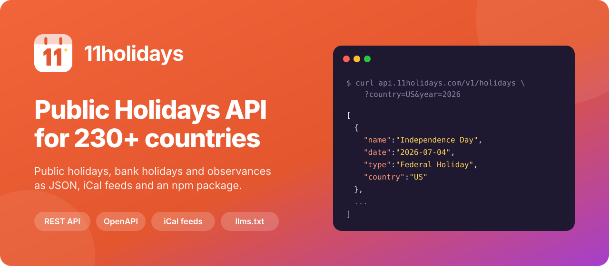

<p align="center">
  <a href="https://11holidays.com/">
    
  </a>
</p>

<p align="center">
  <a href="https://www.npmjs.com/package/11holidays"></a>
  <a href="https://11holidays.com/docs/api"></a>
  <a href="https://api.11holidays.com/v1/openapi.json"></a>
  <a href="https://11holidays.com/llms.txt"></a>
  <a href="LICENSE"></a>
</p>

# 11holidays

Global [holidays API](https://11holidays.com/) for public holidays, bank holidays and observances from 230+ countries. Use it over plain HTTP, through the npm package, or as free iCal feeds.


## Installation

## Contents

- [Get an API key](#get-an-api-key)
- [HTTP API](#http-api)
- [npm package](#npm-package)
- [Free iCal feeds](#free-ical-feeds)
- [For AI agents and LLMs](#for-ai-agents-and-llms)
- [Free tools](#free-tools)
- [Support](#support)

## Get an API key

The REST API needs an API key. [Sign up for a key](https://11holidays.com/api-key), and see [pricing](https://11holidays.com/pricing) for the plans:

| Plan     | Price      | Includes                                                     |
| -------- | ---------- | ------------------------------------------------------------ |
| Yearly   | $99/year   | Unlimited requests, all 230+ countries, historical data      |
| Lifetime | $249 once  | Everything in Yearly, paid once                              |

## HTTP API

- **Base URL:** `https://api.11holidays.com/v1`
- **Authentication:** `Authorization: Bearer YOUR_API_KEY`
- **Reference:** [interactive API docs](https://11holidays.com/docs/api) and the [OpenAPI 3.0 spec](https://api.11holidays.com/v1/openapi.json)

| Method | Endpoint                               | Description                                     |
| ------ | -------------------------------------- | ----------------------------------------------- |
| GET    | `/holidays?country={CODE}&year={YYYY}` | Holidays for a country and year                 |
| GET    | `/holidays/{id}`                       | A single holiday by id                          |
| GET    | `/countries`                           | Supported countries                             |
| GET    | `/occasions`                           | Holidays and festivals with descriptions        |

### List holidays by country and year

```bash
curl "https://api.11holidays.com/v1/holidays?country=US&year=2026" \
  -H "Authorization: Bearer YOUR_API_KEY"
```

```json
[
  {
    "holiday_id": 6093,
    "name": "New Year's Day",
    "date": "2026-01-01",
    "description": "...",
    "occasion_id": 6220,
    "country": "US",
    "type": "Federal Holiday",
    "created_at": "2025-10-28 15:10:10",
    "updated_at": null
  }
]
```

| Parameter | Type    | Required | Description                                  |
| --------- | ------- | -------- | -------------------------------------------- |
| `country` | string  | Yes      | 2 character ISO 3166-1 country code, e.g. `US` |
| `year`    | integer | Yes      | Year in 4 digit format, e.g. `2026`          |

### List countries

```bash
curl "https://api.11holidays.com/v1/countries" \
  -H "Authorization: Bearer YOUR_API_KEY"
```

```json
[
  { "country": "US", "name": "United States" },
  { "country": "IN", "name": "India" }
]
```

### JavaScript (fetch)

```js
const res = await fetch('https://api.11holidays.com/v1/holidays?country=GB&year=2026', {
  headers: { Authorization: `Bearer ${process.env.HOLIDAYS_API_KEY}` },
});
const holidays = await res.json();
```

### Python

```python
import os, requests

res = requests.get(
    "https://api.11holidays.com/v1/holidays",
    params={"country": "IN", "year": 2026},
    headers={"Authorization": f"Bearer {os.environ['HOLIDAYS_API_KEY']}"},
)
holidays = res.json()
```

### Errors

Errors return JSON with a `message`, for example `{ "message": "Invalid API Key" }`.

| Status | Meaning                                            |
| ------ | -------------------------------------------------- |
| 400    | Invalid query or path parameters                   |
| 401    | Missing or invalid API key                         |
| 404    | Holiday not found                                  |

## npm package

[](https://www.npmjs.com/package/11holidays)

```bash
npm i 11holidays
```

```js
import HolidaysApi from '11holidays';

const instance = new HolidaysApi(process.env.HOLIDAYS_API_KEY);

// Holidays for a country and year
const holidays = await instance.holidays.list({ country: 'US', year: 2026 });

// A single holiday by id
const holiday = await instance.holidays.get(6093);

// Supported countries
const countries = await instance.countries.list();
```

Responses are the same JSON as the [HTTP API](#http-api).

## Free iCal feeds

Subscribe to any country's holidays in Google Calendar, Outlook or Apple Calendar. No key needed.

```
https://11holidays.com/ics/{code}              # current and next year
https://11holidays.com/ics/{code}?year=2026    # one year
https://11holidays.com/ics/{code}?public=1     # public holidays only
```

For example [`https://11holidays.com/ics/us`](https://11holidays.com/ics/us).

## For AI agents and LLMs

11holidays is built to be read by AI agents as well as people:

- **[`/llms.txt`](https://11holidays.com/llms.txt)**: a plain-text guide to every page, URL pattern, tool and API endpoint ([llmstxt.org](https://llmstxt.org))
- **[`/.well-known/api-catalog`](https://11holidays.com/.well-known/api-catalog)**: [RFC 9727](https://www.rfc-editor.org/rfc/rfc9727) API discovery that links to the OpenAPI spec and docs
- **[OpenAPI 3.0 spec](https://api.11holidays.com/v1/openapi.json)**: import it as tools in an agent framework, a custom GPT action or an MCP gateway
- **`Link` headers** on every page (`describedby`, `api-catalog`, `service-desc`, `service-doc`), so agents can find the API from any URL
- **Server-rendered HTML** with schema.org JSON-LD (`Event`, `ItemList`, `Dataset`, `FAQPage`)
- **`robots.txt`** allows search and AI crawlers, with [Content Signals](https://contentsignals.org/) `ai-train=yes, search=yes, ai-input=yes`

## Free tools

- [Holiday calendars](https://11holidays.com/calendars): printable and embeddable holiday calendars
- [Long weekends](https://11holidays.com/long-weekends/united-states-of-america): plan trips around public holidays
- [Leave planner](https://11holidays.com/leave-planner): the most days off from your leave budget
- [Working days calculator](https://11holidays.com/working-days-calculator): business days between two dates, excluding holidays
- [Countdown](https://11holidays.com/countdown) and [embeddable widget](https://11holidays.com/widget)
- [All tools](https://11holidays.com/tools)

## Support

- If you have any question related to API key, access etc. [contact support](https://dayschedule.com/contact).
- Open an issue on Github for question related to SDK
